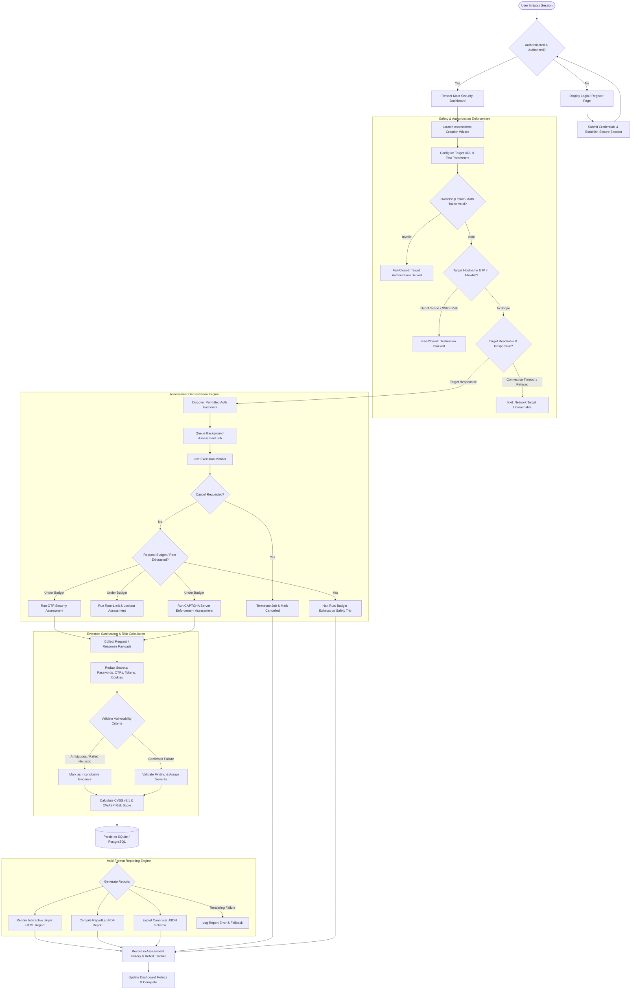

# AuthGuard — Website Authentication Security Assessment & Reporting Platform


**AuthGuard** is a professional, web-based authentication security assessment platform engineered to audit website authentication controls against industry benchmarks (OWASP ASVS v4.0, NIST SP 800-63B).

AuthGuard operates strictly under authorized scopes, bounded request quotas, and safety circuit breakers. It provides security engineering teams with an automated graphical operations console to evaluate:
1. **One-Time Password (OTP) Verification Resilience:** Detection of missing verification checks, invalid code acceptance, token replay/reuse, missing rate limiting, and session decoupling.
2. **Brute-Force & Rate-Limiting Resistance:** Verification of HTTP 429 adherence, Retry-After header enforcement, account lockout progression, and account enumeration defenses.
3. **Server-Side CAPTCHA Enforcement:** Auditing token omission rejection, forged token validation, replay detection, and backend enforcement.
4. **Canonical Multi-Format Security Reporting:** Automated generation of cryptographically signed HTML, PDF (ReportLab), and JSON reports.

---

## System Architecture

AuthGuard follows a decoupled 14-layer architecture separating presentation, safety enforcement, orchestration, and canonical reporting.

```
AuthGuard/
├── app/
│   ├── main.py                    # Application entrypoint & FastAPI routing
│   ├── config.py                  # Pydantic v2 application settings
│   ├── dependencies.py            # Session auth & RBAC permission guards
│   ├── api/                       # REST API & Web Page endpoints
│   ├── core/                      # Security, RBAC, SSRF scope & safety controllers
│   ├── models/                    # SQLAlchemy 2.0 database models
│   ├── schemas/                   # Pydantic serialization schemas
│   ├── assessment_engine/         # Safe HTTP client, OTP, Rate Limit & CAPTCHA suites
│   ├── evidence/                  # Secret redaction & SHA-256 integrity hashing
│   ├── risk/                      # CVSS v3.1 & OWASP risk scoring engine
│   ├── reporting/                 # HTML, ReportLab PDF, and JSON report generator
│   ├── static/                    # Dark SOC theme CSS and vanilla JS modules
│   └── templates/                 # Jinja2 layouts and web views (Pages A–L)
├── lab/
│   └── demo_auth_app/             # Isolated vulnerable/secure demonstration testbed
├── tests/                         # Pytest automated test suite (Unit, Integration, E2E)
├── scripts/
│   ├── measure_loc.py             # Official reproducible LOC measurement utility
│   └── run_sample_audit.py        # End-to-end sample audit & report generator
├── storage/                       # Report artifacts, database, and evidence
├── requirements.txt               # Pinned dependencies
├── pyproject.toml                 # Package definition
├── Dockerfile                     # Production container definition
├── docker-compose.yml             # Full-stack composition
└── README.md
```

### End-to-End Execution Flowchart



---

## Quickstart & Local Setup

### 1. Prerequisites
- Python 3.10+ (Tested on Python 3.12 and 3.14)
- Pip package manager

### 2. Installation
```bash
# Clone or navigate to the project directory
cd AUTHTEST

# Install dependencies
pip install -r requirements.txt
```

### 3. Local Startup
Start the AuthGuard Web Console:
```bash
python -m uvicorn app.main:app --host 127.0.0.1 --port 8000 --reload
```
Open your browser to: **`http://127.0.0.1:8000`**

*(Default seeded administrator: `admin` / `AdminPass123!`)*

### 4. Running the Isolated Demonstration Testbed
In a second terminal, start the demonstration testbed:
```bash
python -m uvicorn lab.demo_auth_app.main:app --host 127.0.0.1 --port 8001
```
The testbed features dual modes:
- **`POST http://127.0.0.1:8001/api/mode/vulnerable`** — Enables authentication vulnerability demonstrations.
- **`POST http://127.0.0.1:8001/api/mode/secure`** — Enables hardened authentication defenses.

---

## Automated Verification & Testing

Run the automated test suite (20 unit, integration, and E2E tests):
```bash
python -m pytest -v
```

Execute an end-to-end sample security audit and generate real HTML, PDF, and JSON reports:
```bash
python scripts/run_sample_audit.py
```

Generated reports are saved to `storage/reports/` with SHA-256 verification hashes.

---

## Official LOC Measurement Script

Measure codebase lines of code using strict accounting rules:
```bash
# General measurement report
python scripts/measure_loc.py --root .

# Strict threshold verification
python scripts/measure_loc.py --root . --strict --minimum 500000

# Save / compare against baseline
python scripts/measure_loc.py --root . --baseline baseline_loc.json
```

---

## Authorized-Use & Safety Policy

> [!IMPORTANT]
> AuthGuard is engineered strictly for authorized security assessments, defensive pre-deployment validation, and compliance benchmarking. 
> 
> - **SSRF Protection:** All outgoing HTTP requests are resolved and filtered against cloud metadata (169.254.169.254) and internal networks.
> - **Request Budgeting:** Strict request quotas (default: 250 requests) and concurrency limits ensure target availability is never endangered.
> - **Circuit Breakers:** Four consecutive 5xx errors automatically trip the safety breaker and halt testing.
> - **Secret Sanitization:** All passwords, OTP codes, session tokens, and sensitive headers are redacted before persistence or reporting.
